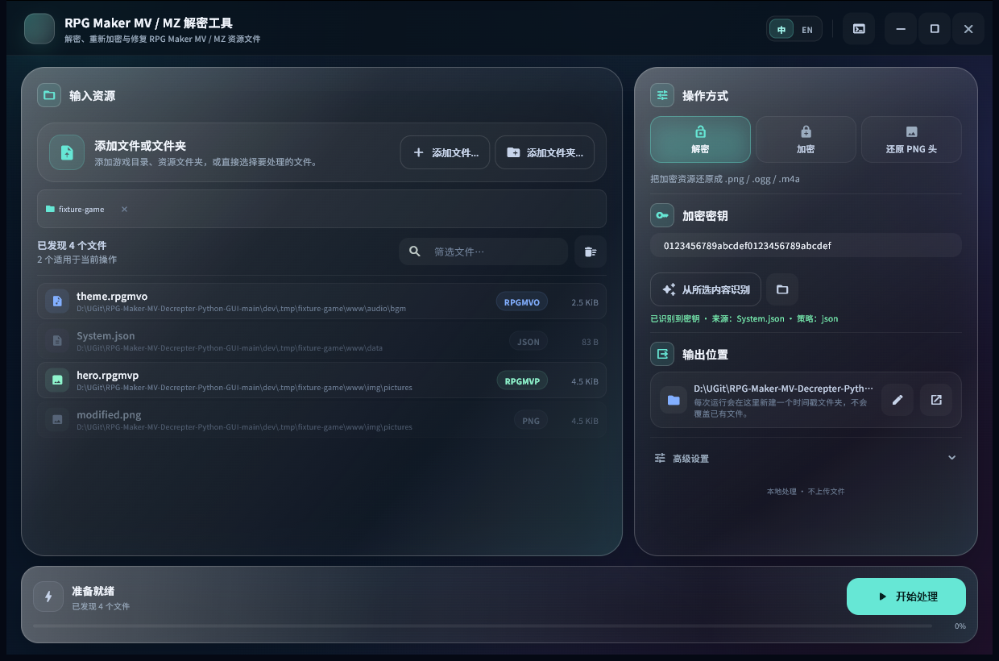
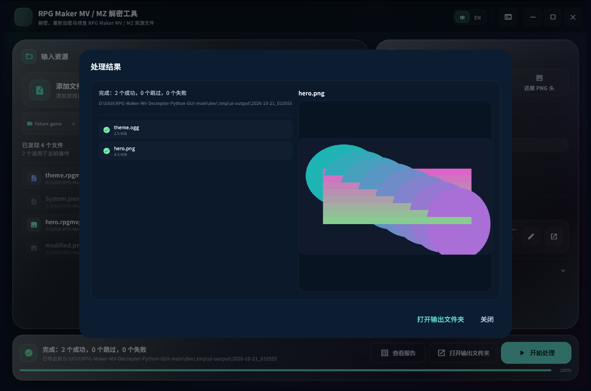
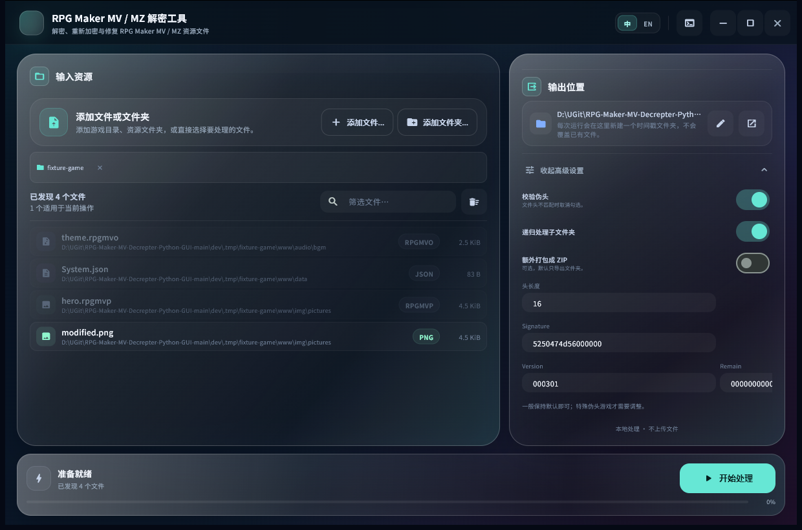
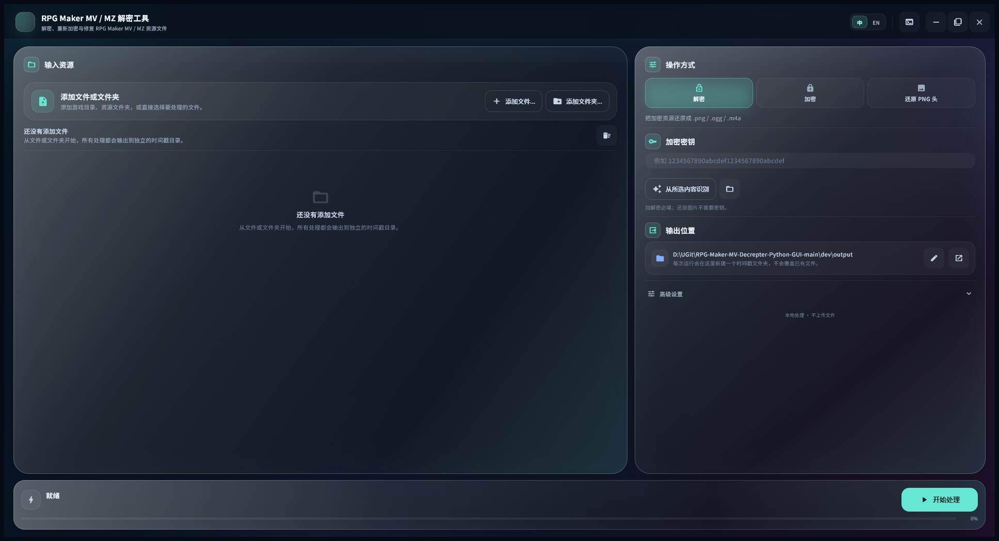

<p align="center">
  
</p>

# RPG Maker MV/MZ Decrypter

一个用于 **RPG Maker MV / MZ** 资源文件的本地解密、重加密与修复工具。项目提供 Flet 桌面界面、命令行和纯标准库 Python API。

- 桌面界面：Flet（Flutter 渲染），中英文切换
- 命令行：无需第三方依赖
- Python API：无需第三方依赖
- 加密/解密：XOR + 16 字节伪头
- 图片：无密钥也能还原标准 PNG 头
- 不依赖网络服务，不上传用户文件

## 界面预览









## 支持格式

| 加密格式（MV） | 加密格式（MZ） | 明文格式 | 类型 |
| --- | --- | --- | --- |
| `.rpgmvp` | `.png_` | `.png` | 图片 |
| `.rpgmvo` | `.ogg_` | `.ogg` | 音频 |
| `.rpgmvm` | `.m4a_` | `.m4a` | 音频 |

支持从 `System.json`、`rpg_core.js` 或任意加密图片中识别密钥。

## 环境要求

- Python 3.10+
- Windows 10/11（桌面打包版本）
- 桌面界面需要 `flet[desktop]>=1.0,<2`
- `.venv` 由 `python setup.py deps` 自动创建
- 测试需要 `pytest>=7.0`、`PyYAML>=6.0`
- 代码检查需要 `ruff>=0.9`
- 打包需要 `pyinstaller>=6.11`

核心库和 CLI 只使用 Python 标准库。

## 安装依赖（自动创建 .venv）

```powershell
python setup.py deps --mirror
```

`setup.py deps` 会在项目根目录创建 `.venv`，并将 Flet 桌面依赖、pytest、PyYAML、ruff 和 PyInstaller 只安装到这个虚拟环境，不会写入系统 Python。只运行桌面界面时：

```powershell
python setup.py deps --runtime-only
```

检查虚拟环境：

```powershell
python setup.py check
```

如果没有 `.venv`，`check` 会提示先运行 `deps`；如果从系统 Python 调用，它会自动切换到 `.venv` 检查。运行前先激活：

```powershell
.\.venv\Scripts\Activate.ps1
```

cmd 用户：

```bat
.venv\Scripts\activate.bat
```

如需 CLI 和 GUI 安装入口，再把项目安装进虚拟环境：

```powershell
python -m pip install -e .
```

Windows 快捷脚本会优先使用 `.venv`；没有 `.venv` 时会回退到 PATH 中的 `python`。

## 启动桌面界面

从源码目录启动（已激活 `.venv`）：

```powershell
python flet_main.py
```

Windows 下也可以双击或运行：

```powershell
.\run_flet.cmd
```

完成 `pip install -e .` 并激活 `.venv` 后可使用：

```powershell
rpgmv-decrypter-gui
```

桌面界面支持：

- 文件/文件夹选择与递归扫描
- 解密、MV/MZ 加密、无密钥 PNG 头还原
- 自动密钥识别
- 输出根目录选择
- 递归、ZIP、伪头校验与自定义头参数
- 后台任务、进度、取消、运行日志
- 结果报告、打开输出目录、图片预览
- 中英文即时切换

### 桌面界面说明

- 文件选择使用系统原生对话框；暂不支持从资源管理器拖放文件或文件夹。
- 液态玻璃外观由半透明面板、渐变边框、径向光晕和阴影组合实现；Flet 未暴露 Flutter 的 `BackdropFilter`，因此不是实时背景折射。
- 图片结果预览上限为 16 MB；音频结果提供文件信息和输出目录入口。
- 每次运行输出到新的时间戳目录，不覆盖已有结果。

## 打包 Windows 桌面版

已激活 `.venv` 时：

```powershell
python build_flet.py
```

或直接运行：

```powershell
.\build_flet.cmd
```

产物：

```text
dist-flet\RPGMakerDecrypterFlet\RPGMakerDecrypterFlet.exe
dist-flet\RPGMakerDecrypter-<version>-windows-x64.zip
```

请保留整个 `RPGMakerDecrypterFlet` 文件夹。程序首次启动会在自身目录下创建 `.runtime` 保存 Flet 缓存和临时文件；如果安装目录只读，则回退到系统用户目录。

构建脚本会自动执行 `RPGMakerDecrypterFlet.exe --self-test`，验证加解密、PNG 头还原、密钥恢复和资源文件完整性。

## 命令行

以下命令需要在项目根目录并已激活 `.venv`：

```powershell
python -m rpgmv_decrypter --help
```

子命令：

| 子命令 | 作用 |
| --- | --- |
| `decrypt` | 解密加密资源 |
| `encrypt` | 把明文资源重新加密为 MV/MZ 格式 |
| `restore` | 无密钥还原加密图片的 PNG 头 |
| `detect-key` | 检测游戏/文件密钥 |
| `info` | 只读查看文件类型和头信息 |

示例：

```powershell
# 解密一张图片
python -m rpgmv_decrypter decrypt -k 0123456789abcdef0123456789abcdef hero.rpgmvp

# 解密整个游戏目录，导出并额外打包 ZIP
python -m rpgmv_decrypter decrypt --auto-key MyGame -o output --zip output\game.zip

# 加密为 MZ 格式
python -m rpgmv_decrypter encrypt -k 0123456789abcdef0123456789abcdef hero.png --rpg-maker MZ

# 无密钥还原 PNG 头
python -m rpgmv_decrypter restore MyGame\www\img -o restored

# 检测密钥
python -m rpgmv_decrypter detect-key MyGame\www\data\System.json

# 查看文件信息
python -m rpgmv_decrypter info MyGame\www\img\pictures\hero.rpgmvp
```

退出码：

- `0`：全部处理成功，跳过项不算失败
- `1`：至少一个文件失败
- `2`：参数或路径错误

## Python API

公开 API 的稳定契约见 [`INTERFACE.md`](INTERFACE.md)。

```python
from rpgmv_decrypter import Decrypter, decrypt_paths, detect_key

key = detect_key("MyGame/www/data/System.json").key
Decrypter(key).decrypt_file(
    "MyGame/www/img/pictures/hero.rpgmvp",
    "hero.png",
)

result = decrypt_paths(
    ["MyGame/www/img"],
    key,
    "decrypted",
)
print(result.summary())
```

批量 API 返回 `RestoreResult`，其中包含每个文件的 `FileOutcome`、成功/失败/跳过统计和输出路径。

## 工作原理

1. 明文前 16 字节与游戏密钥做 XOR。
2. 在最前面加入未加密的 16 字节伪头。
3. 后续内容原样复制。

```text
plain      [ 16 bytes ][          rest of file          ]
                | XOR key                    | copied
                v                            v
encrypted  [ fake header ][ 16 bytes ][          rest of file          ]
```

图片可以无密钥还原：PNG 的前 16 字节固定，因此直接重建标准 PNG 头即可。加密图片的第二块也足以反推出密钥。完整格式说明见 [`docs/HEADER.md`](docs/HEADER.md)。

## 项目结构

```text
rpgmv_decrypter/       # 核心库：解密、密钥识别、批量 API、CLI、UI 无关逻辑
flet_app/              # Flet 桌面界面
  assets/              # 界面图标与纹理
flet_main.py           # 桌面程序入口与 --self-test
build_flet.py          # Flet/PyInstaller 打包、校验与 ZIP
setup.py               # 创建 .venv、安装依赖与环境检查
pyproject.toml         # 包元数据、入口点、可选依赖和工具配置
tests/                 # pytest 测试
docs/                  # 文件格式、兼容性和预览截图
.github/workflows/     # 测试、Windows 构建与 Release
```

## 测试与检查

已激活 `.venv` 时：

```powershell
python -m pytest -q
```

Windows 快捷方式：

```powershell
.\run_tests.cmd
```

代码风格检查：

```powershell
python -m ruff check rpgmv_decrypter flet_app tests flet_main.py build_flet.py setup.py
```

## 持续集成

`.github/workflows/build.yml` 在 push、PR、手动触发和版本 tag 时运行：

1. 通过 `setup.py deps` 创建 `.venv` 并安装依赖
2. 执行 `setup.py check`
3. 运行 pytest
4. 构建 Windows 目录版应用
5. 运行打包程序的 `--self-test`
6. 上传 ZIP artifact
7. tag 与 `pyproject.toml` 版本一致时创建 GitHub Release

## 法律声明

本项目基于 [Petschko/RPG-Maker-MV-Decrypter](https://github.com/Petschko/RPG-Maker-MV-Decrypter) 的格式说明和算法重写。

- 解出的资源仅可用于你拥有合法授权的内容。
- 请遵守游戏和素材的许可协议。
- 不要使用本工具绕过你无权访问的版权保护。
- 原作品和本项目均使用 MIT License；第三方游戏资源不在此许可范围内。

## License

[MIT](LICENSE)